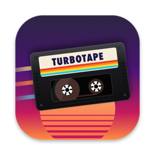

<p align="center">
  
</p>

# TurboTape

A native macOS app that cuts your videos to the beat of a song and exports a vertical short video.

**Pick a song → drop videos or a folder → Generate → Shuffle until you like it → fine-tune → Export.**

- Beat, bar and onset detection; cuts land on beats, faster in loud parts of the song (Pace: Chill / Normal / Hype).
- Picks sharp, well-exposed, well-composed moments, never across a hard cut inside a clip, and uses every clip before repeating one.
- Landscape footage is reframed to 9:16 and follows faces or the most salient subject.
- **Move a cut:** drag it in the timeline. It snaps to beats, half-beats and hits; hold ⌥ to drag freely. You can also select a cut and press ←/→ to move it 1 frame, or ⇧←/→ to jump to the previous or next beat.
- **Choose which part of a clip plays:** select a shot, then scroll over it, press `,` / `.` (1 frame) or `⇧,` / `⇧.` (1 s), ⌘-drag it, or drag the highlighted part in the strip below the timeline.
- Edited shots are pinned and kept by Shuffle (⌘R). Shuffle All (⌥⌘R) ignores pins. Full undo.
- Export: H.264 1080×1920 30 fps 12 Mbps with the hardware encoder, AAC 48 kHz, music normalized to −14 LUFS (peaks ≤ −1 dBFS).

## Build

Requires Xcode 16+ and [XcodeGen](https://github.com/yonaskolb/XcodeGen) (`brew install xcodegen`).

```sh
xcodegen                     # creates TurboTape.xcodeproj from project.yml (not committed)
open TurboTape.xcodeproj     # or: xcodebuild -scheme TurboTape build
swift test                   # engine tests (no Xcode project needed)
```

## Layout

| Path                          | What                                                         |
| ----------------------------- | ------------------------------------------------------------ |
| `Sources/TurboTapeKit/Audio`  | decoding, beat tracking, loudness                            |
| `Sources/TurboTapeKit/Video`  | frame sampling, shot detection, scoring, focus for reframing |
| `Sources/TurboTapeKit/Edit`   | timeline model, planner, roll/slip edits, snapping           |
| `Sources/TurboTapeKit/Render` | composition, reframing compositor, exporter                  |
| `Sources/turbotape-cli`       | the same pipeline from the terminal                          |
| `App/`                        | the SwiftUI app                                              |

## CLI

```sh
swift run -c release turbotape-cli generate --music song.mp3 --clips ~/Movies/raw --length 30 --seed 1 --out short.mp4
swift run -c release turbotape-cli inspect short.mp4
```

Clip analyses are cached in `~/Library/Caches/TurboTape` (inside the app's container for the app).
